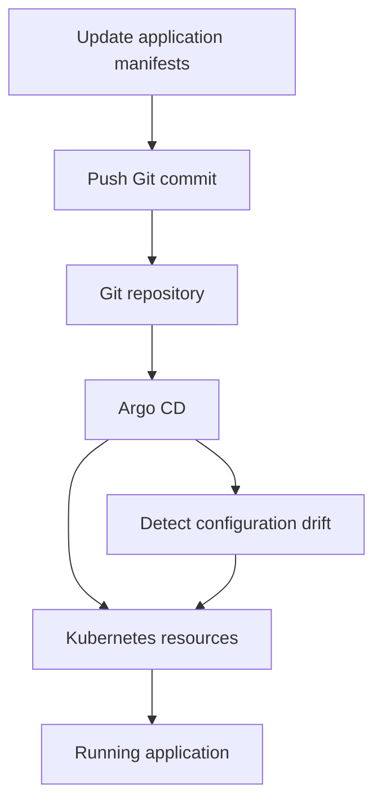

<div align="center">


### Build the cluster. Route the traffic. Automate the deployment.

A 42 curriculum infrastructure project exploring Kubernetes with K3s, K3d, Vagrant, Argo CD, and a local GitLab deployment.

<br />


<br /><br />

[Overview](#overview) · [Project Parts](#project-parts) · [Getting Started](#getting-started) · [GitOps Workflow](#gitops-workflow) · [Troubleshooting](#troubleshooting)

</div>

<br />

## Overview

Inception of Things is a hands-on introduction to Kubernetes infrastructure and deployment automation.

The project progresses from a two-node K3s cluster to application routing, then introduces GitOps with Argo CD. The bonus extends the setup with a GitLab instance running inside Kubernetes.

The repository contains Vagrant configurations, provisioning scripts, Kubernetes manifests, and cleanup scripts.

<br />

## Project Parts

| Part | Focus | Implementation |
| :--- | :--- | :--- |
| **Part 1** | Cluster fundamentals | K3s server and worker on two Vagrant VMs |
| **Part 2** | Application routing | Three applications exposed through Traefik Ingress |
| **Part 3** | GitOps deployment | K3d cluster with Argo CD and automatic synchronization |
| **Bonus** | Local Git hosting | GitLab CE in Kubernetes connected to Argo CD |

<br />

## Part 1 — K3s Server & Worker

Part 1 provisions two Ubuntu virtual machines and connects them into a Kubernetes cluster.

| Role | VM name | Private IP |
| :--- | :--- | :--- |
| **Server** | `aes-sargS` | `192.168.56.110` |
| **Worker** | `aes-sargSW` | `192.168.56.111` |

### Implementation

- Vagrant provisions both machines using VirtualBox.
- The server installs K3s and starts the Kubernetes API.
- Its join token is written to the shared Vagrant directory.
- The worker waits for the token and API availability before joining.
- The configuration selects the private network interface for cluster traffic.

The server script disables Traefik, ServiceLB, and metrics-server for this part.

### Concepts

Node roles, cluster bootstrapping, join tokens, private networking, and service startup dependencies.

<br />

## Part 2 — Applications & Ingress

Part 2 provisions a single K3s server and deploys three HTTP applications.

Each application has a Deployment and Service. Traefik routes incoming requests according to their host header.

| Request host | Destination |
| :--- | :--- |
| `app1.com` | `app1` |
| `app2.com` | `app2` |
| `app3.com` | `app3` |
| Unknown host or direct IP | `app3` |

The `app2` Deployment runs **three replicas**.

### Concepts

Deployments, replicas, Service selectors, container ports, and host-based Ingress routing.

<br />

## Part 3 — Argo CD & GitOps

Part 3 creates a K3d cluster and installs Argo CD.

The setup script:

1. Installs Docker, K3d, and kubectl.
2. Creates `dev-cluster` with two agent nodes.
3. Creates the `argocd` and `dev` namespaces.
4. Installs Argo CD and its CLI.
5. Configures repository access using an SSH key.
6. Creates the `playground` Argo CD application.
7. Enables automated sync, self-healing, and pruning.
8. Opens port-forwarding for the application.

### Default access

| Service | Port |
| :--- | :--- |
| **Argo CD** | `8080` |
| **Playground application** | `8888` |
| **Cluster load balancer** | `80` / `443` |

### Repository configuration

The current script references:

```text
git@github.com:0xk1/Inception-of-things.git
```

It watches the `main` branch and the `p3/app` path.

Before running this part, update the repository references in `p3/scripts/script.sh` if you want Argo CD to track your own repository.

The script expects an SSH private key at:

```text
~/.ssh/id_ed25519
```

That key must have access to the configured repository.

<br />

## Bonus — GitLab Inside Kubernetes

The bonus introduces a local Git source for the GitOps workflow.

The setup:

- Creates the required Kubernetes namespaces.
- Installs or reuses Argo CD.
- Deploys GitLab Community Edition.
- Creates a private `playground` project in GitLab.
- Pushes the application manifests into that project.
- Registers GitLab repository credentials with Argo CD.
- Configures Argo CD to deploy from the local GitLab repository.

### GitLab storage & resources

| Setting | Value |
| :--- | :--- |
| Namespace | `gitlab` |
| Persistent volume claim | `10Gi` |
| CPU request | `1` |
| Memory request | `3Gi` |
| CPU limit | `3` |
| Memory limit | `6Gi` |

The manifest uses the `Recreate` deployment strategy and mounts persistent storage at `/var/opt/gitlab`.

### Default forwarded ports

| Service | Host port |
| :--- | :--- |
| **Argo CD** | `8080` |
| **GitLab HTTP** | `8081` |
| **Playground** | `8888` |
| **Additional forwarded port** | `30222` |

The bonus Vagrant configuration enables automatic port correction. Check `vagrant port` if the expected host port is unavailable.

<br />

## GitOps Workflow



The repository defines the desired application state.

Argo CD monitors that state and applies changes to Kubernetes. With self-healing enabled, it can reconcile drift. With pruning enabled, it can remove managed resources that are no longer defined in Git.

In Part 3, the source is the configured GitHub repository. In the bonus, it is the local GitLab project.

<br />

## Repository Structure

| Path | Contents |
| :--- | :--- |
| `p1/Vagrantfile` | Server and worker VM definitions |
| `p1/scripts/` | K3s installation and worker joining |
| `p2/Vagrantfile` | Single-server VM configuration |
| `p2/scripts/install.sh` | K3s installation and manifest deployment |
| `p2/confs/` | Application Deployments, Services, and Ingress |
| `p3/scripts/script.sh` | K3d and Argo CD setup |
| `p3/scripts/cleanup.sh` | Part 3 cleanup script |
| `p3/app/` | Playground application manifests |
| `bonus/Vagrantfile` | Bonus VM configuration |
| `bonus/confs/gitlab.yaml` | GitLab Deployment, Service, and storage |
| `bonus/scripts/setup.sh` | GitLab and Argo CD integration |
| `bonus/scripts/cleanup.sh` | Bonus cleanup script |

<br />

## Getting Started

### Prerequisites

For the Vagrant-based parts:

- Vagrant.
- VirtualBox compatible with the host architecture and configured Ubuntu box.
- Hardware virtualization support.
- Available private networking in the `192.168.56.0/24` range.

For Part 3:

- An Ubuntu/Debian Linux environment with sudo access.
- An SSH key authorized for the configured Git repository.
- Available ports required by the setup.

The provisioning scripts use `apt` and Linux system services.

### Clone

```bash
git clone https://github.com/ayoub-essarghini/IOT-inception-of-things.git
cd IOT-inception-of-things
```

### Run Part 1

From the repository root:

```bash
cd p1
vagrant up
vagrant ssh aes-sargS
```

Inside the server VM:

```bash
sudo k3s kubectl get nodes -o wide
```

Confirm that both the server and worker become `Ready`.

### Run Part 2

From the repository root:

```bash
cd p2
vagrant up
vagrant ssh
```

Inside the VM:

```bash
kubectl get deployments
kubectl get pods
kubectl get services
kubectl get ingress
```

From a host that can reach the VM:

```bash
curl -H "Host: app1.com" http://192.168.56.110
curl -H "Host: app2.com" http://192.168.56.110
curl -H "Host: app3.com" http://192.168.56.110
curl http://192.168.56.110
```

Part 1 and Part 2 reuse the same server IP. Run them separately to avoid conflicting virtual machines.

### Run Part 3

Review the repository URL and SSH key configuration first.

From the repository root, inside the Linux environment:

```bash
bash p3/scripts/script.sh
```

Check the result:

```bash
kubectl get nodes
kubectl get pods -n argocd
kubectl get pods -n dev
argocd app get playground
```

### Run the Bonus

Increase the VM memory allocation in `bonus/Vagrantfile` before running it. The current `1024 MB` allocation is below GitLab's `3Gi` memory request and does not account for the rest of the cluster.

From the repository root:

```bash
cd bonus
vagrant up
vagrant ssh
```

Check the deployed services:

```bash
kubectl get pods -n gitlab
kubectl get pvc -n gitlab
kubectl get pods -n argocd
kubectl get pods -n dev
argocd app get playground
```

The bonus script defines lab defaults for GitLab credentials. Review and configure these before exposing the environment beyond a local lab.

<br />

## Useful Commands

### Cluster inspection

```bash
kubectl get nodes -o wide
kubectl get pods -A
kubectl get deployments -A
kubectl get services -A
kubectl get ingress -A
```

### Application debugging

```bash
kubectl describe deployment playground -n dev
kubectl logs deployment/playground -n dev
kubectl get events -n dev --sort-by=.metadata.creationTimestamp
```

### GitOps inspection

```bash
argocd app list
argocd app get playground
argocd app diff playground
```

### Vagrant inspection

Run these from the relevant part directory:

```bash
vagrant status
vagrant port
```

<br />

## Troubleshooting

| Problem | What to check |
| :--- | :--- |
| **Worker does not join** | Server readiness, shared token, and access to port `6443` |
| **Wrong application response** | Host header, Ingress rules, and Service selectors |
| **Pods stay Pending** | Node capacity, resource requests, and storage availability |
| **Argo CD cannot access Git** | Repository URL, SSH key permissions, or GitLab credentials |
| **Application does not update** | Watched branch, manifest path, and Argo CD sync status |
| **GitLab is slow to start** | VM memory, pod events, readiness checks, and storage |
| **Expected port is unavailable** | Existing processes and Vagrant's corrected port mappings |

<br />

## Engineering Focus

- Provisioning reproducible virtual environments.
- Bootstrapping server and worker nodes.
- Routing requests through Kubernetes Services and Ingress.
- Managing application state declaratively.
- Synchronizing Git changes with a running cluster.
- Hosting a Git service inside Kubernetes.
- Diagnosing networking, resource, and startup issues.

<br />

## Current Scope

This repository is a learning environment for Kubernetes and GitOps.

Its scripts include local lab assumptions such as fixed IP addresses, predefined repository references, port-forwarding, and default credentials. Some dependencies use moving release URLs or `latest` image tags.

Review these settings when adapting the project to another environment.

<br />

---

<div align="center">

**42 Curriculum · Infrastructure · Kubernetes · GitOps**

[GitHub](https://github.com/ayoub-essarghini) · [Portfolio](https://www.ayoub-essarghini.com/) · [LinkedIn](https://www.linkedin.com/in/ayoub-es-sarghini-839973212)


</div>
